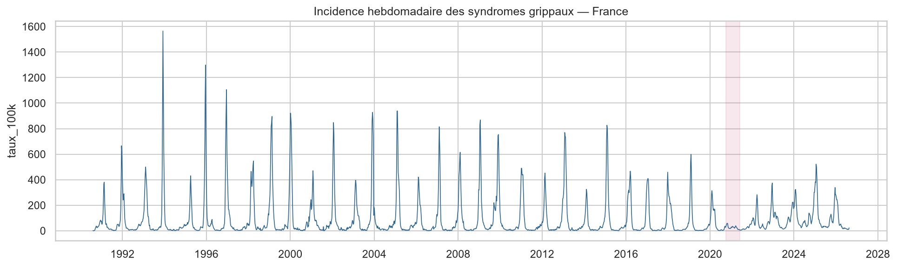

# Prévision de l'incidence des syndromes grippaux en France — réseau Sentinelles


Prévision hebdomadaire de l'**incidence des syndromes grippaux en France
métropolitaine** à partir de l'historique de surveillance du **réseau
Sentinelles** (Inserm / Sorbonne Université), avec comparaison de modèles
statistiques classiques, de machine learning et d'un modèle profond.

> **À propos de ce projet.** Docteur en biotechnologie, j'ai l'habitude des données biomédicales et de leur
> interprétation. Ce projet met en pratique la **prévision de série temporelle**
> de bout en bout : exploration, saisonnalité, modélisation, et surtout
> **évaluation honnête par backtest** — la partie que l'on néglige le plus
> souvent.



*Trente saisons grippales. En rouge, l'hiver 2020-2021 : les mesures COVID ont
fait quasi disparaître la grippe — une rupture qu'aucun modèle ne peut anticiper.*

---

## Le jeu de données

Le **réseau Sentinelles** est un réseau de médecins généralistes volontaires qui
remontent chaque semaine, depuis 1984, le nombre de cas vus pour un ensemble de
pathologies. Les données sont **publiques** et exposées via une API REST
(`sentiweb.fr`).

**Indicateur principal** : *syndromes grippaux* (indicateur 3), incidence
hebdomadaire estimée pour la France (`geo=PAY`) et par région (`geo=REG`).

- Historique : **2 182 semaines** au niveau national (depuis octobre 1984,
  restreint à partir de 1990 pour la modélisation), plus la déclinaison régionale.
- Une observation = une semaine ISO (`yearweek` au format `AAAASS`), avec
  l'incidence estimée, le taux pour 100 000 habitants et les bornes d'incertitude.
- Saison typique : pic entre fin décembre et mi-février (semaine ISO ~6), creux
  l'été (semaine ~32), amplitude qui varie d'un facteur 3 à 5 selon les années.
- **Anomalie franche en 2020-2021** : les mesures COVID ont fait quasi disparaître
  la grippe (pic à 59 / 100 000 contre 314 la saison précédente) — cas d'école
  pour discuter la robustesse d'un modèle.

**Enrichissement optionnel** (features exogènes) :

- **Météo-France** — données SYNOP publiques (température, humidité) : la
  circulation grippale est liée aux conditions hivernales.
- **Indicateurs annexes Sentinelles** — IRA (infections respiratoires aiguës),
  diarrhée aiguë, comme régresseurs corrélés.
- Calendrier des **vacances scolaires** (data.gouv.fr) — effet sur les contacts.

**Volumétrie** : quelques Mo. Petite en octets mais **riche en structure** —
c'est le nombre de cycles saisonniers (30+ saisons) qui compte pour une série
temporelle, pas le poids du fichier.

---

## La tâche

Prévoir l'incidence nationale à horizon **1 à 4 semaines**, en conditions
réalistes : à chaque semaine `t`, on ne connaît que l'historique jusqu'à `t`
(pas de fuite du futur).

Questions traitées :

- Quelle est la **part saisonnière** vs la tendance vs le bruit ?
- Un modèle statistique simple (SARIMA, Holt-Winters) suffit-il, ou les
  approches ML / deep learning apportent-elles un gain réel ?
- Sait-on prévoir le **moment et l'amplitude du pic épidémique** ?
- Comment se comportent les modèles sur la saison **atypique 2020-2021** ?

---

## Pipeline

| Notebook | Étape | Points clés |
|----------|-------|-------------|
| `01_acquisition_donnees` | Export CSV Sentinelles, parsing des semaines ISO, cache local | `yearweek` `AAAASS` → date du lundi ; calendrier hebdo strict |
| `02_exploration` | Série, décomposition STL, profil saisonnier, ACF/PACF, stationnarité (ADF) | pic à ~52 sem. ; différenciation saisonnière ; repérage de 2020-2021 |
| `03_modeles_statistiques` | Naïf saisonnier, Holt-Winters, SARIMA ; prévision longue vs courte ; diagnostic des résidus | SARIMA gagne en prévision courte ; Holt-Winters instable |
| `04_machine_learning` | Features de décalage, fenêtres glissantes, calendrier ; Ridge et gradient boosting (prévision récursive) | importance des features ; validation croisée temporelle |
| `05_deep_learning_lstm` | LSTM univarié (Keras 3 / backend PyTorch), fenêtre d'un an, arrêt anticipé | courbe d'apprentissage ; comparaison honnête au coût de complexité |
| `06_backtest_synthese` | **Backtest à origine glissante** 2016-2024, MAE / RMSE / MASE par horizon, erreur de pic, focus 2020-2021 | tableau et figures de synthèse ; recommandation |

Fonctions réutilisables dans [`src/`](src/) ; tests dans [`tests/`](tests/) ;
synthèse rédigée dans [`reports/synthese.md`](reports/synthese.md).

---

## Compétences démontrées

- **Séries temporelles** — décomposition, stationnarité, autocorrélation,
  saisonnalité, modèles SARIMA et lissage exponentiel.
- **Machine learning appliqué au temporel** — construction de features de
  décalage, validation croisée à origine glissante (sans fuite du futur),
  modèles d'ensemble.
- **Deep learning** — LSTM sous Keras 3, avec un regard critique sur le rapport
  gain / complexité (conclusion : il ne se justifie pas ici).
- **Évaluation rigoureuse** — backtest, métriques adaptées (MASE), évaluation
  spécifique du pic épidémique, test sur une saison anormale.
- **Communication** — narration claire, figures de prévision avec intervalles,
  recommandation argumentée.

---

## Résultats (backtest 2016-2024, MASE — < 1 = mieux que le naïf saisonnier)

- **SARIMA et Fourier + ARIMA battent le naïf saisonnier** à tous les horizons,
  surtout à court terme (MASE ~0,5 à 1 semaine, ~0,8-0,9 à 4 semaines).
- **Fourier + ARIMA** (régression harmonique + erreurs ARIMA) fait aussi bien que
  SARIMA pour une fraction du temps de calcul — le meilleur rapport qualité/coût.
- **Le gradient boosting et le LSTM n'apportent rien** sur cette série nationale
  seule : la relation est courte et déjà bien captée par un modèle statistique.
  Ils redeviendraient pertinents avec les 13 régions en parallèle et des variables
  exogènes (météo, vacances scolaires).
- **Horizon utile : 1 à 3 semaines.** Au-delà, tous les modèles convergent vers le
  naïf. Le pic épidémique se cale à ±1-2 semaines et ±15-25 % d'amplitude.
- **Angle mort assumé** : les ruptures de régime (2020-2021) sont par nature
  imprévisibles à partir de la seule série.

## Reproduire l'analyse

```bash
python -m venv .venv
.venv/Scripts/pip install -r requirements.txt        # Windows ; sinon .venv/bin/pip
KERAS_BACKEND=torch .venv/Scripts/jupyter lab        # backend torch pour le notebook 05
# exécuter les notebooks dans l'ordre (01 → 06)
```

Les données Sentinelles sont téléchargées et mises en cache dans `data/raw/`
(non versionné) au premier lancement du notebook 01. Python 3.14 ; versions
figées dans [`requirements.txt`](requirements.txt).

---

## Sources

- **Réseau Sentinelles**, Inserm / Sorbonne Université, `https://www.sentiweb.fr`.
  Données publiques. Citation demandée : *Équipe de Surveillance et modélisation
  des maladies transmissibles, réseau Sentinelles (IRD/Inserm/Sorbonne Université).*
- **Météo-France** — données publiques SYNOP, `https://donneespubliques.meteofrance.fr`.
- Hyndman RJ, Athanasopoulos G. **Forecasting: Principles and Practice.**
  (référence méthodologique, notamment MASE et backtest à origine glissante).

Code publié sous licence MIT.
